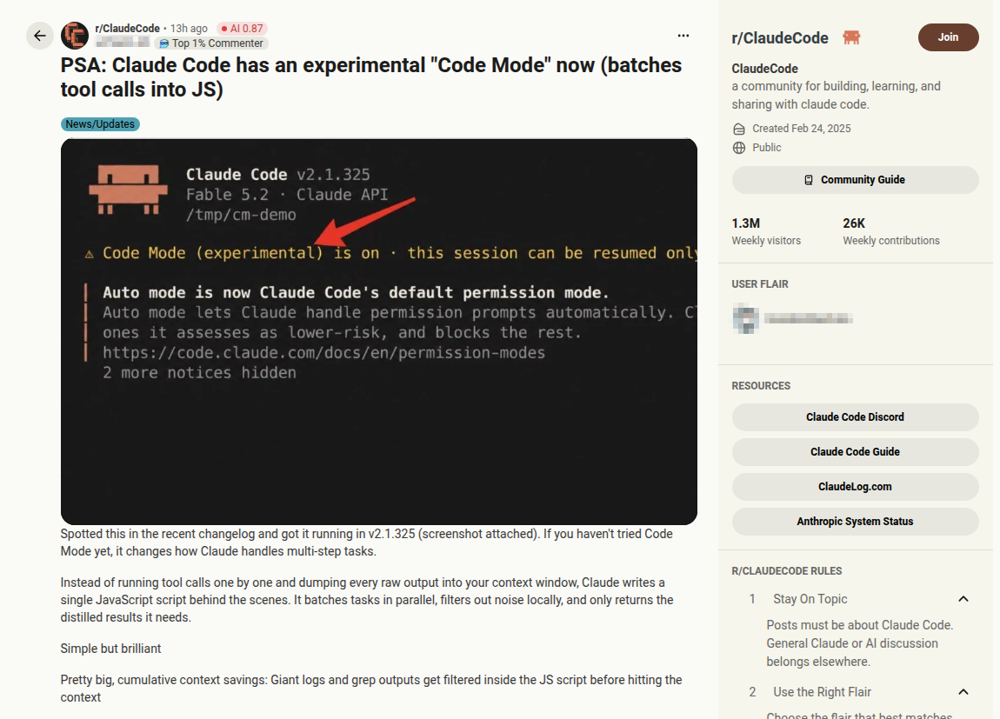
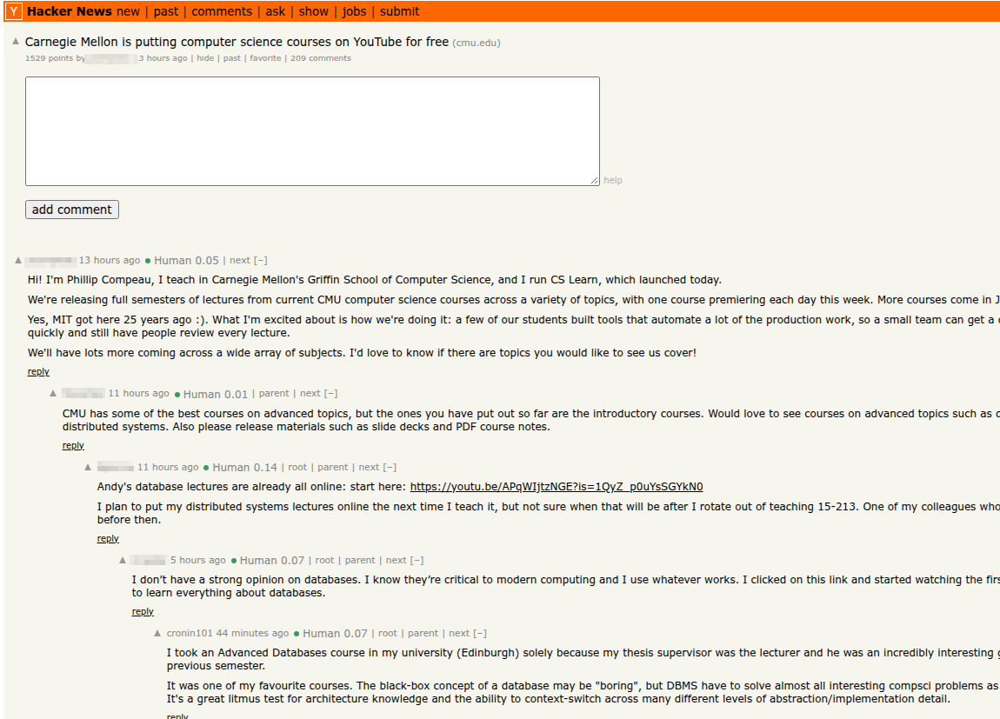
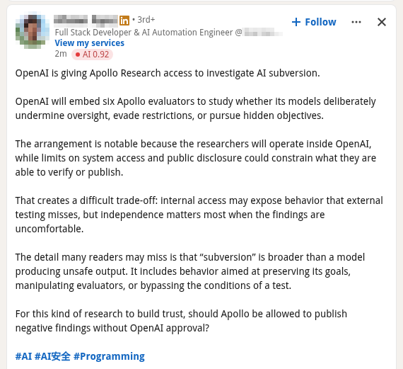

# Slop Detect

A Chrome extension that marks posts and comments as `AI 0.93` or `Human 0.04`. The model
runs in your browser, so no text leaves the machine.



Works on Reddit, LinkedIn, Hacker News and X.

<p>
  
  
  
</p>

## Model

[VoightKampffLabs/voi-slop-detect-380M](https://huggingface.co/VoightKampffLabs/voi-slop-detect-380M),
the 8-bit quantized ONNX export.

- Downloaded from Hugging Face once (450 MB), after you click "Download model".
- Runs on the GPU through WebGPU, or on the CPU through WebAssembly.
- Scores English texts of 30 tokens or more, and the first 512 tokens of a long one.
- The score is an estimate and can be wrong.

## Build

```
npm install
npm run build          # .output/chrome-mv3
```

Load `.output/chrome-mv3` at `chrome://extensions` ("Load unpacked", developer mode).
Needs Chrome 116 or newer.

## Code

| part | where |
|---|---|
| content script: finds the texts, draws the badges | `entrypoints/feed.content.ts`, `src/content/` |
| model host: an offscreen document shared by all tabs | `entrypoints/offscreen/`, `src/host/` |
| worker: tokenizes, batches, runs ONNX Runtime | `src/inference/` |
| sites: selectors for each site, one file per site | `src/sites/` |
| pages: popup, options, welcome, log | `entrypoints/` |

To add a site, add a `Site` to `src/sites/` and list it in `src/sites/index.ts`.

## Test

```
npm test                              # unit tests
npm run e2e -- --backend webgpu       # the built extension in Chromium; also wasm, auto
```

The e2e run needs Playwright's Chromium (`npx playwright-core install chromium`) and a
model export at `../slop-detector/runs/voi-slop-detect-380M/web`, or `--model <dir>`.
